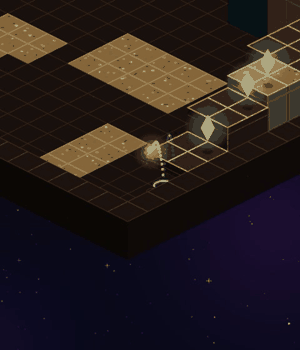
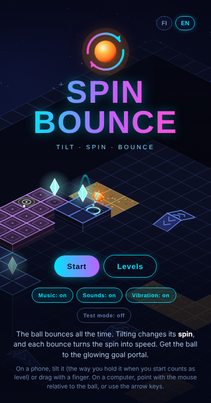
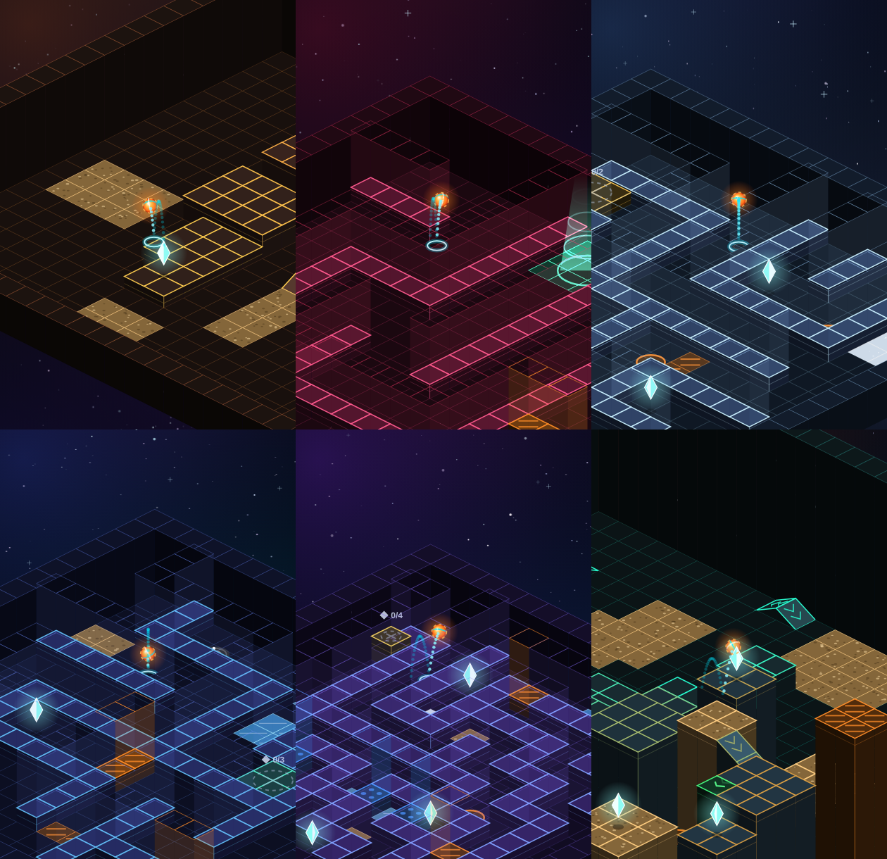

# Spinbounce

**Tilt · Spin · Bounce** — an isometric physics puzzle game where you never steer the ball directly.

▶ **Play in the browser:** https://heikkihe.github.io/spinbounce/
(works on phones with tilt control, and on computers with the mouse or arrow keys)

<p align="center">
  
  
</p>

**Author:** Heikki Heinonen · GitHub [@HeikkiHe](https://github.com/HeikkiHe)

*[Suomeksi alempana](#suomeksi)*

---

## The idea

The ball bounces all the time, always to the same height. While it is in the air you cannot change its path at all.
**Tilting the phone only changes the ball's spin** — and every time the ball hits the ground, friction turns that spin
into speed. To land on a platform you have to plan the spin one bounce ahead: spin up to build speed, spin the other
way to brake, and time the bounce so it clears an edge right at the top of its arc.

**The game idea and the game mechanic — spin-controlled bouncing steered by tilting the device — are by
Heikki Heinonen.** The concept grew from the classic C64 game *Wizball*, where the ball's spin also mattered, into an
isometric puzzle game.

## Features

- **100 levels in 9 worlds**, each with its own look and music: Star Stairs, Asteroid Belt, Ziggurat, Labyrinth,
  Ice Comet, Jump Station, Pillar Forest, Light Bridges and Crater.
- **Real ball physics**: friction couples spin and motion, bounce height is constant, every surface behaves differently.
- **Surfaces**: ice, half-ice, sand (puffs up and slows you down), snow (soft, leaves tracks), sticky pads, dampers,
  trampolines, boosters and sloped tiles that launch the ball across gaps.
- **Puzzles**: crystals that unlock the goal portal, colour-coded switches that raise and lower gates,
  and teleporter pairs. Some levels are puzzle rooms where the order of actions matters.
- **Steadily rising difficulty**, measured by actually playing every level (see below).
- **Amiga-style soundtrack**: a 4-channel tracker with 8-bit samples, hard stereo, arpeggio chords and smooth
  cross-fades between worlds, plus synthesised sound effects and phone vibration.
- **Show solution**: any level can be watched being solved, move by move.
- **English and Finnish**, progress saved in the browser, test mode with all levels open.

<p align="center"></p>

## Controls

| Device | How to play |
|---|---|
| Phone | Tilt the phone. The way you hold it when you start counts as level. Or drag with a finger. |
| Computer | Point with the mouse relative to the ball — the further away, the faster the spin. Or use the arrow keys. |

Tilt control needs the page to be served over HTTPS (GitHub Pages does this). On iPhone the browser asks for
permission to use motion sensors when you press *Start*.

## How it was made

The game was designed and directed by Heikki Heinonen and **implemented with Claude (Anthropic), an AI assistant**.
The author came up with the game idea and mechanic, chose the direction (isometric view, puzzles instead of time
limits, themed worlds, space look, Amiga-style music) and tested and steered every step; Claude wrote the code,
the level generator, the music and the sound effects.

Under the hood:

- **One file, no dependencies.** The whole game is a single `index.html` using Canvas 2D and the Web Audio API.
- **Generated, verified levels.** Levels are built procedurally, platform by platform. Every jump is checked by
  simulating it with the game's own physics, and a shortcut guard rejects layouts where a later platform can be
  reached directly from the floor.
- **A bot that plays every level.** A search-based player tries tilt sequences in the physics simulation and finds
  a complete solution for each level, including puzzle order. The number of moves it needs is used as the
  difficulty measure, and the final 100 levels were chosen from about 290 candidates so that difficulty rises
  smoothly. The same solutions power the in-game *Show solution* button.

## Repository

```
index.html          the game (open it in a browser, or publish with GitHub Pages)
LICENSE             GNU General Public License v3.0
docs/               screenshots and animation for this README
tools/              build tools (Node.js)
  phys.js           ball physics shared by the game and the tools
  gen.js, gen2.js   level generator with reachability and shortcut checks
  bot.js            the solver bot; botpool.js runs it on all candidate levels
  build5.js         picks the final levels by measured difficulty and builds index.html
  template.html     the game code; music.js (tracker), i18n.js (languages)
  *.json            generated level candidates and bot results
```

Rebuilding the game from the tools: `cd tools && node build5.js pool7.json ../index.html`

## License

Copyright (C) 2026 Heikki Heinonen

This program is free software: you can redistribute it and/or modify it under the terms of the
GNU General Public License as published by the Free Software Foundation, either version 3 of the License,
or (at your option) any later version. See [LICENSE](LICENSE).

---

## Suomeksi

**Kallista · Pyöritä · Pomppaa.** Spinbounce on isometrinen fysiikkapulmapeli, jossa palloa ei ohjata suoraan.

Pallo pomppii koko ajan samaan korkeuteen, eikä sen lentoon voi ilmassa vaikuttaa. **Puhelimen kallistus muuttaa
vain pallon pyörimistä**, ja jokainen pomppu muuttaa pyörimisen kitkan avulla vauhdiksi. Tasolle pääsee, kun
suunnittelee pyörimisen pompun verran etukäteen: kiihdyttää, jarruttaa vastakierteellä ja ajoittaa pompun niin,
että pallo ylittää reunan lakipisteessään.

**Peli-idea ja pelimekaniikan idea – laitetta kallistamalla ohjattu, pyörimiseen perustuva pomppiminen – ovat
Heikki Heinosen.** Idea lähti liikkeelle C64:n *Wizballista* ja kehittyi isometriseksi pulmapeliksi.

**Toteutus:** peli on suunniteltu ja ohjattu tekijän toimesta, ja se on **toteutettu Claude-tekoälyavustajan
(Anthropic) avulla**. Tekijä keksi idean ja mekaniikan, linjasi suunnan (isometrinen näkymä, pulmat aikarajan sijaan,
teemamaailmat, avaruusilme, Amiga-henkinen musiikki) sekä testasi ja ohjasi jokaisen vaiheen. Claude kirjoitti
koodin, kenttägeneraattorin, musiikin ja äänitehosteet.

Pelissä on 100 kenttää yhdeksässä maailmassa, erilaisia pintoja (jää, hiekka, lumi, tarrapinta, vaimennin,
trampoliini, kiihdytin ja viistot pinnat), pulmia (kiteet, kytkimet ja portit, teleportit), Amiga-tyylinen
musiikki, ratkaisujen näyttö sekä suomen ja englannin kieli. Kentät on luotu ohjelmallisesti, jokainen hyppy on
tarkistettu simuloimalla, ja botti on pelannut kaikki kentät läpi. Botin tarvitsemien siirtojen määrällä on
mitattu vaikeus, jotta peli vaikeutuu tasaisesti.

Lisenssi: GNU GPL v3.0 tai uudempi. © 2026 Heikki Heinonen.
